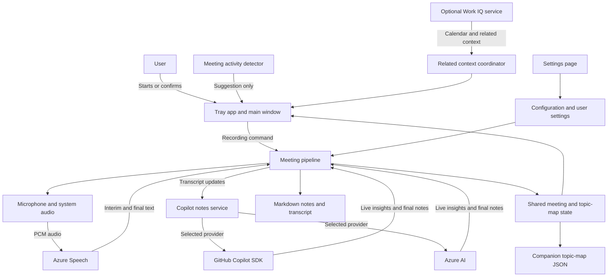

# Architecture

Meeting Capture is a Windows tray app. Its main window handles setup and recording controls; the tray menu provides quick actions. A recording suggestion is only a prompt. A user must start or confirm a recording before the app captures audio.

## Main parts

- **Tray app (`App`, `MainWindow`)** creates the services, shows the tray menu and window, and sends user actions to the recording pipeline. The Settings page saves service, audio, and storage choices.
- **Meeting detection (`ProcessMeetingDetector`)** checks configured meeting-app processes and Windows microphone-session activity. It can suggest a meeting, but it never starts recording.
- **Audio capture (`AudioCapture`)** reads microphone audio and system output audio. When both are enabled, `DualSourceCapture` aligns and mixes them into one PCM stream.
- **Transcription (`AzureSpeechTranscriptionService`)** streams PCM audio to Azure Speech and returns interim and final transcript segments. Final segments include speaker labels when Speech provides them.
- **Recording pipeline (`MeetingPipeline`)** owns the recording lifecycle: starting and stopping capture, sending audio to transcription, keeping transcript state, requesting analysis, and saving completed sessions.
- **Meeting notes and topic map (`Intelligence`, `MeetingVisualizationSession`)** use the Copilot SDK with either GitHub Copilot or Azure AI. A shared session model feeds the live topic, question, action, decision, topic-map, and topic-notes views. The final summary is generated separately from the completed transcript.
- **Work IQ (`WorkIqService`, `RelatedContextCoordinator`)** is an optional connection to a signed-in work account. It can provide calendar matches, attendee details, and related work content. It is separate from audio capture and transcription.
- **Storage (`Storage`)** writes notes and the recognized transcript to Markdown. Topic-map data is written to a companion JSON file. If that sidecar cannot be saved, the app keeps it pending for a later retry.
- **Settings (`UserSettingsManager`)** reads optional `appsettings.json`, then the per-user settings file, .NET user secrets, and environment variables. Values saved in the Settings page go to `%APPDATA%\MeetingCapture\settings.user.json`; service keys entered there are not encrypted.

## Data flow

The pipeline sends recognized speech to the selected AI provider for live analysis. When recording stops, it also requests a final summary from the completed transcript. The Markdown file keeps the recognized transcript even if AI generation fails; generated notes are included when available. The topic-map view is saved separately as JSON. The app does not save raw audio. Work IQ can add calendar or related-content information, but it does not control whether audio is captured or transcribed.

## Configuration and external services

Azure Speech is used for transcription. Meeting intelligence can use GitHub Copilot or Azure AI, selected in Settings. GitHub Copilot model access uses the Copilot CLI runtime included with the app; the user must have an authenticated GitHub CLI account with Copilot access. Azure AI uses the configured endpoint, key, API version, and deployment names.

Work IQ sign-in uses a system browser and an organizational account. Its local token cache is protected for the current Windows user. Meeting recording and note storage do not require Work IQ.

The app saves its settings under the current user's profile and meeting files in the configured notes folder. The Markdown file contains the recognized transcript and may include participant details. Treat that folder and the settings file as private data.
